# MGR-GB OS Manual

**[Português](MANUAL.md)** · [Back to the README](README.en.md)

This manual shows, screen by screen, how to prepare the card with **MGR-GB OS · Manager** and how to use the menu on the console.

## 1. Before you start

1. You need an **EverDrive GB** running the GBOS system (tested on the **EverDrive GB Extreme**, EXTREME REV.E board) and a microSD card in **FAT32**.
2. The package **does not include ROMs, covers or cheats**: the ROMs are yours; the program downloads covers and cheats the first time.
3. Make **a copy of the card's contents** before the first write. The program deletes nothing and keeps a backup of what it replaces, but the card is yours and a separate backup is worth it.
4. After writing, use **Safely remove** in Windows before taking the card out.

## 2. Opening the program

Open **`MGR-GB-OS-Gerenciador.exe`** (a single file, no installation). The top menu has **File**, **Theme** (the program's look), **Idioma / Language** (Portuguese or English) and **Help**. On the left are the five pages: **Game Boy**, **Game Boy Color**, **Theme**, **System** and **Write to the card**.

**Updates:** on startup the program checks the GitHub Releases; if a newer version exists, a notice appears in the side bar with what is new and a **Download and update** button. It verifies the SHA-256, keeps the current `.exe` as `.exe.anterior` and reopens already updated. You can turn the check off in **Help > Check when the program starts** or check right away in **Help > Check for updates…**.

## 3. The Game Boy and Game Boy Color pages

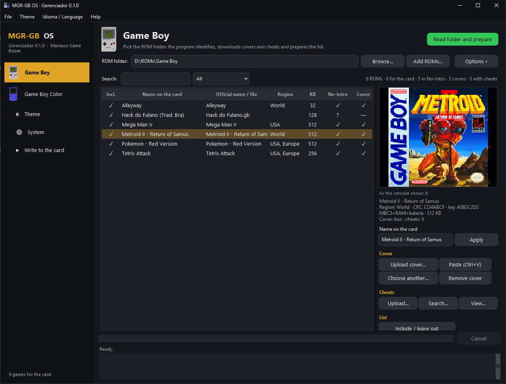

1. Under **ROM folder**, click **Browse…** and pick the folder (the same one can serve both consoles: the program splits them by each ROM's header). **Add ROMs…** adds loose files.
2. Click **Read folder and prepare**. The program:
   - identifies each game by **content** (CRC32 against the No-Intro database), including ROMs inside `.zip` files;
   - picks the **good copies** (one per game, in the preferred region);
   - downloads the **cover** (box art, else title screen, else snapshot) and the **cheats** by official name.
3. The table shows, per game: whether it is **included**, the **name on the card**, the official name, the region, the size, whether No-Intro recognized it, whether it has a cover and how many cheats. Use **Search** and the filter (included, excluded, no cover, no cheats, not in No-Intro). Double-click a row to include or leave out the game.
4. In the right-hand panel, for the selected game:
   - **Name on the card:** what the console list will show; **Apply** saves the change.
   - **Cover:** **Upload cover…** (file), **Paste (Ctrl+V)**, **Choose another…** or **Remove cover**.
   - **Cheats:** **Upload…** your own `.cht`, **Search…** again or **View…** and remove codes.
   - **Include / leave out of the card.**
5. **Options ▸** controls the file names on the card, the preferred region, the card folders, whether bad dumps are discarded, whether hacks and translations outside No-Intro are included, and whether covers and cheats are downloaded when the folder is read.

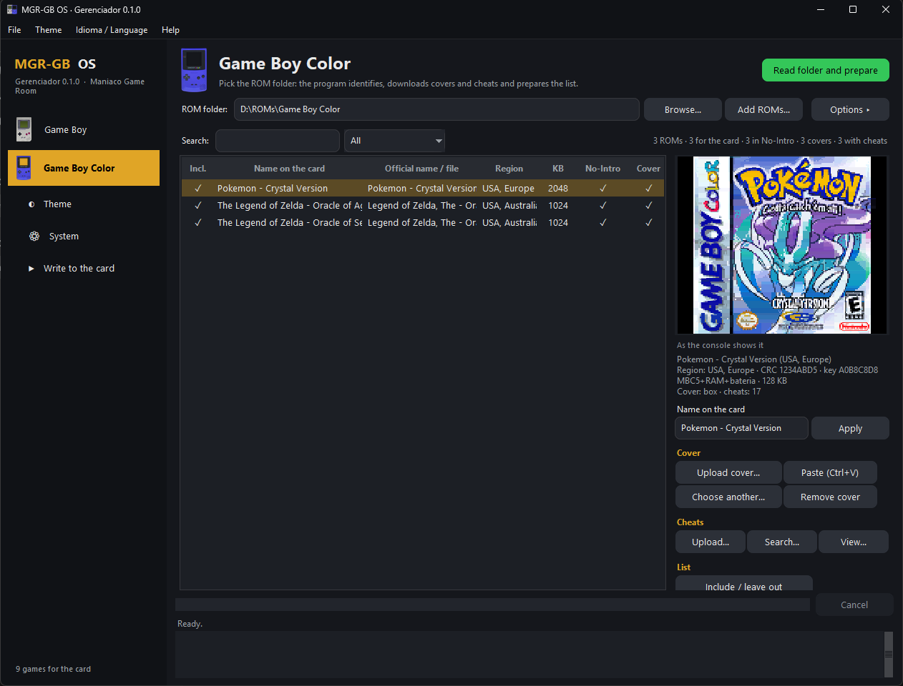

The **Game Boy Color** page is the same, for `.gbc` games. **File > Save project** keeps the list in a `.mgrgb.json` (it points to your ROMs, it does not embed them).

### A card that already has games

If the card is already full, use **Read games from the card** (on the Game Boy and Game Boy Color pages). The program reads the ROMs of **every root folder** (except `EDGB`, `COVERS` and `CHEATS`; not `.zip`), splits Game Boy and Game Boy Color by the header, **keeps each game where it is, unrenamed**, and downloads covers and cheats. Then **Write to the card** only adds covers, cheats, the preview and the menu. Folders with their own names also get the console image and go into alphabetical order. On a large library the first cover conversion takes a while (thousands of covers take about an hour with the improved converter; the **Standard** converter is much faster).

### Choose another cover

**Choose another…** opens a window with search by name and the list of available images (box, title, snapshot). Clicking an option shows the **original image** and then **how the console shows it**. Double-click to choose.

## 4. The Theme page

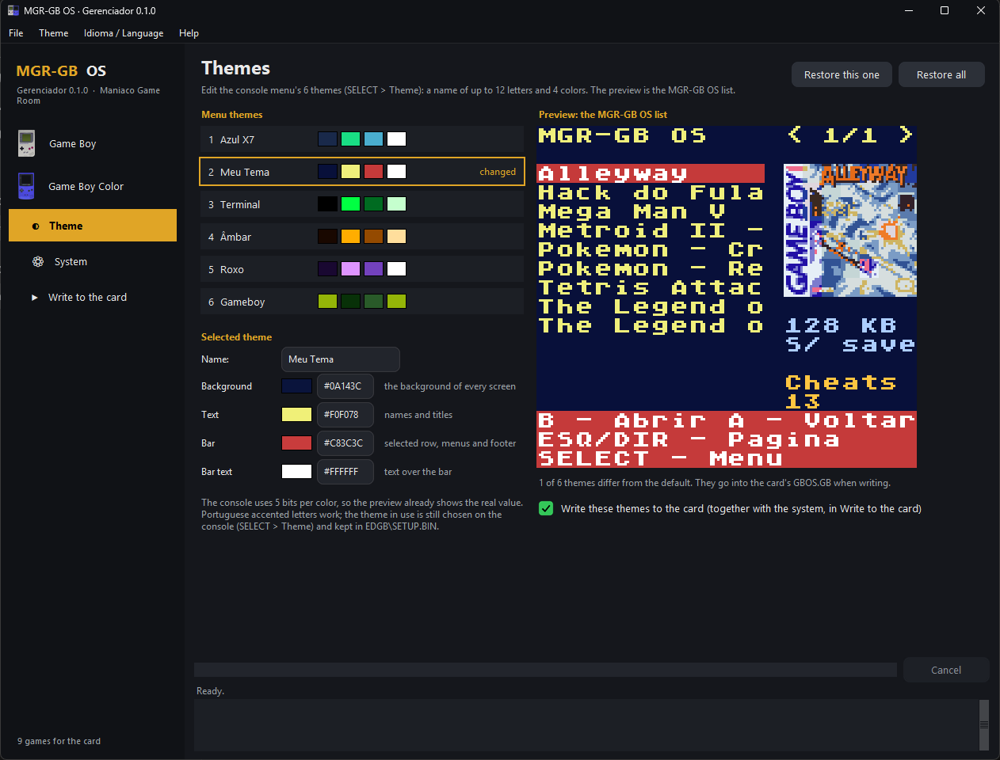

The console menu has **6 themes** (SELECT > Theme). Here you edit each one: a **name of up to 12 letters** (accents work) and **4 colors** (background, text, bar and bar text). The preview beside it is the **real MGR-GB OS list**, drawn with the console's font and a game cover, and it changes as you move the colors. The console uses 5 bits per color, so the preview already shows the real value. **Restore this one** and **Restore all** go back to the defaults.

The themes go into the menu when writing (tick *Write these themes to the card*). The program only changes **data** (colors, names and the pointer table), never menu code. The theme **in use** is still chosen on the console and kept in `EDGB\SETUP.BIN`, which the program never touches. Limit: 6 themes at a time.

## 5. The System page

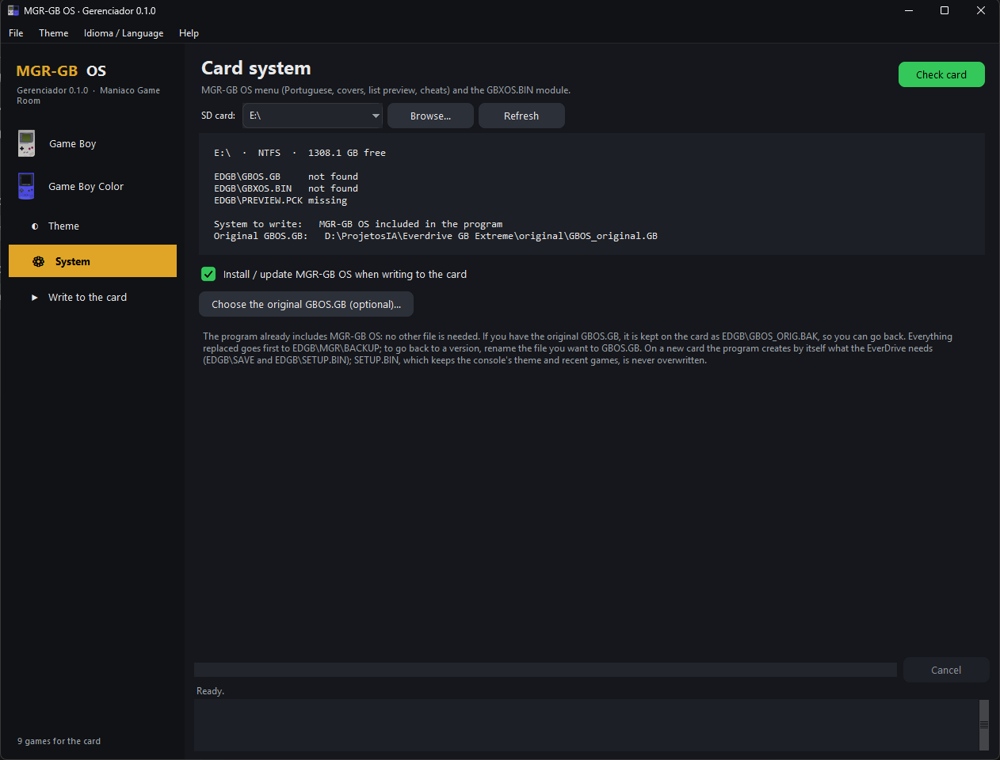

Pick the card drive (**Browse…** or **Refresh**) and click **Check card** to see what is on it. Keep *Install / update MGR-GB OS when writing to the card* ticked so the program installs the menu (`EDGB\GBOS.GB` and `EDGB\GBXOS.BIN`). The program already carries MGR-GB OS ready to install, so no other file is needed. If you have the original Krikzz `GBOS.GB` (on the card or chosen in **Choose the original GBOS.GB (optional)…**, SHA-256 `a4f92e99…66ae`), it is kept as `EDGB\GBOS_ORIG.BAK` so you can go back.

To go back to a menu version, rename the file you want (`GBOS_ORIG.BAK` or a copy in `EDGB\MGR\BACKUP\<date>`) to `GBOS.GB`.

## 6. The Write to the card page

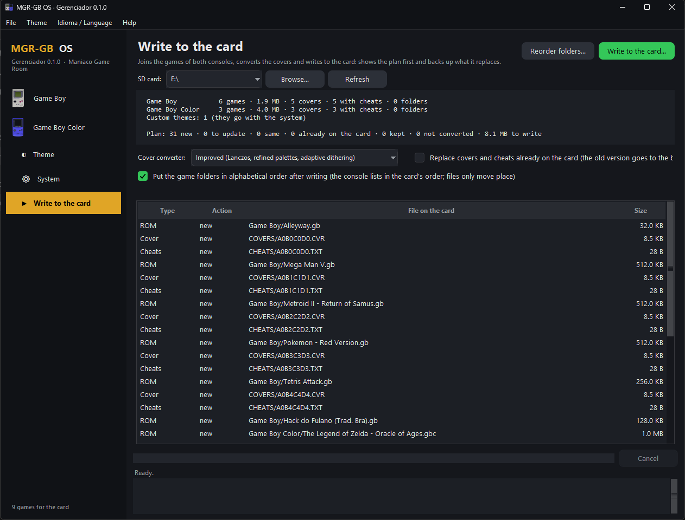

1. Pick the card and the **cover converter**: **Improved** (default) or **Standard**.
2. Optionally tick *Replace covers and cheats already on the card* (the old version goes to the backup) and *Put the game folders in alphabetical order after writing* (on by default).
3. Click **Write to the card…**. The program converts the covers (the footer shows how many are done and **how much is left**, recomputed from the real pace), builds the **plan** and shows the table with every file: type, action (new, update, same…), path on the card and size.
4. Confirm with **Yes**. Only then does the program write.

### What is written to the card

| On the card | What |
|---|---|
| `Game Boy\` and `Game Boy Color\` | the chosen ROMs, with the title as the file name. Subfolders only above **700 games** in one folder |
| `COVERS\<key>.CVR` | the large color cover (~8.7 KB). The key comes from the ROM header, not the name |
| `CHEATS\<key>.TXT` | Game Genie cheats (up to 28 per game) |
| `EDGB\PREVIEW.PCK` | the list preview (small cover, size, battery, RTC/SGB and cheats); the console folders at the root get the console image and the count |
| `EDGB\GBOS.GB` and `EDGB\GBXOS.BIN` | the MGR-GB OS menu and its module |
| `EDGB\SAVE\` and `EDGB\SETUP.BIN` | what the menu needs on a new card (the saves folder; theme and recents), created only if missing |
| `EDGB\GBOS_ORIG.BAK` | the original GBOS, if you have it |
| `EDGB\MGR\BACKUP\<date>\` and `EDGB\MGR\DIARIO\` | what was replaced and a journal of each write |

### Safety rules

- **Nothing is deleted from the card.** The program only adds and updates.
- Anything replaced goes first to `EDGB\MGR\BACKUP\<date>`. Each file is written to a temporary file, flushed to disk, swapped in and **verified afterwards**.
- **A ROM is never overwritten:** if the name already exists with other content, the new one goes as `Name (2).gb`. A ROM already on the card is not copied again.
- Covers and cheats already on the card **stay as they are**, unless you ask to replace them.
- The menu (`GBXOS.BIN` and `GBOS.GB`) is the **last step**; if the second file fails, the first goes back to what it was.
- Before writing the program checks: **FAT32** card, free space and whether the drive is removable (a fixed disk asks for confirmation). A new, empty card is normal: the program creates by itself what the EverDrive needs.
- `EDGB\SETUP.BIN` is created **only if missing** and, once it exists, is **never touched**.

### Covers: conversion and cache

Covers are downloaded from libretro-thumbnails and **converted on your PC** (instead of shipping a ready-made pack: the art belongs to its owners, and the list preview depends on each collection's file names and cheats). Each cover takes about 13 s of one core, and several run in parallel. The result is cached in `%LOCALAPPDATA%\MGR-GB-OS\conversao`, so only the first write is slow (**Help > Clear the cache**).

### Game order in the list

The menu **does not sort**: it lists files in the order of the entries in the card's directory. So the program writes ROMs **in alphabetical order** (case-insensitive, numbers by value), straight to the final name.

**Reorder folders…** puts a card that already has games in order: **Game Boy**, **Game Boy Color**, their subfolders and the two folders at the root. For each folder out of order, the entries are **moved** (a rename inside the same card, no data copied) to `EDGB\MGR\REORDENAR` and come back in order. Before touching the games the program **proves the mechanism in a small test folder** on the card itself; a journal lets it **put everything back** if the operation is interrupted; at the end the real order is checked. **Nothing is deleted.** Do not remove the card while it runs (a few seconds).

## 7. On the console

### The game list

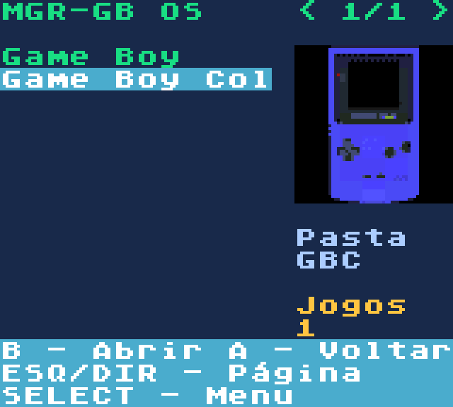

The root shows the **Game Boy** and **Game Boy Color** folders, with the console image and the game count. **B** opens the folder.

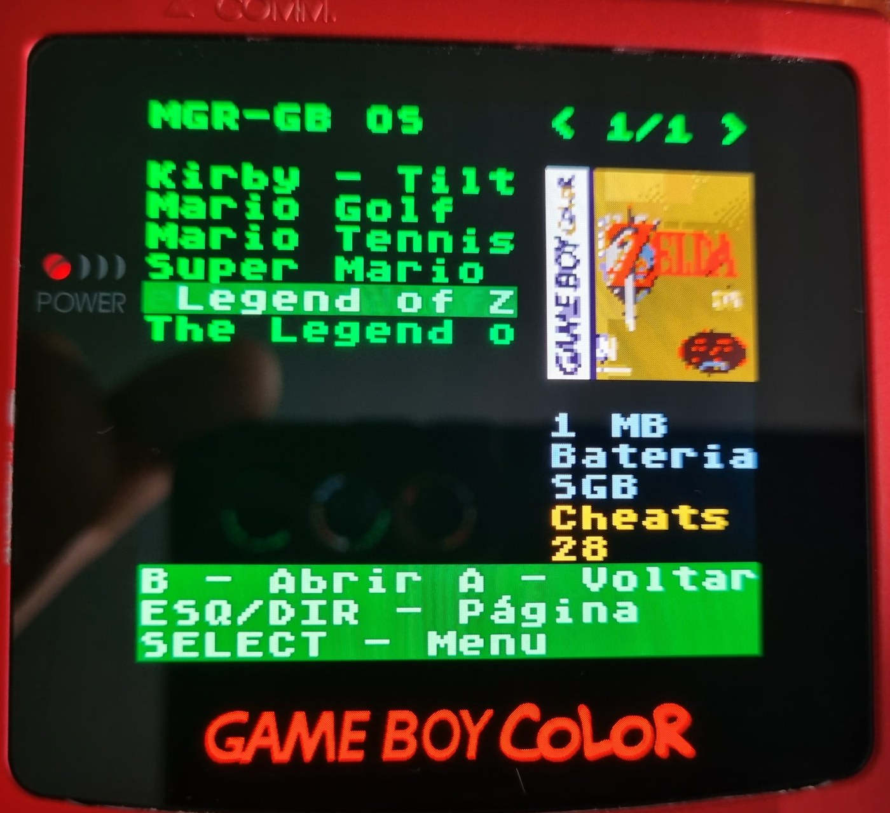

- **Up and down:** pick the game. When you stop on a game, the **preview** shows on the right: small cover, ROM size, **Bateria** (battery) or "S/ save", **RTC** and **SGB** marks, and the number of **Cheats** (amber; a dim "Sem cheats" when there are none).
- **Left and right:** change page.
- **B:** opens the game's cover (or starts the game, if it has no cover).
- **A:** goes back one folder.
- **START:** goes back to the last game.
- **SELECT:** opens the menu.

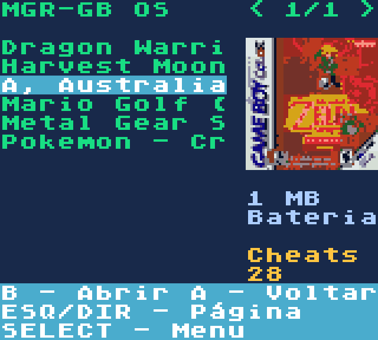

### The cover

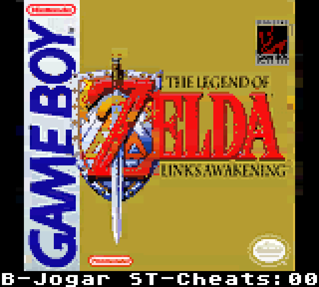

The cover fills the screen with about 600 colors. The footer reads **B-Jogar** (play) and **ST-Cheats:NN** (how many cheats are on). **B** starts the game; **START** opens the cheats; **SELECT** goes back to the list.

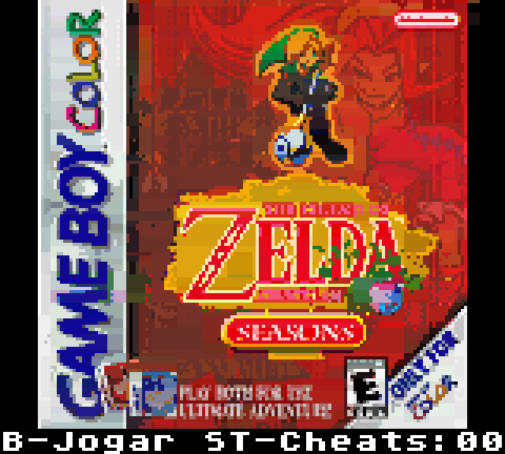

### The cheats

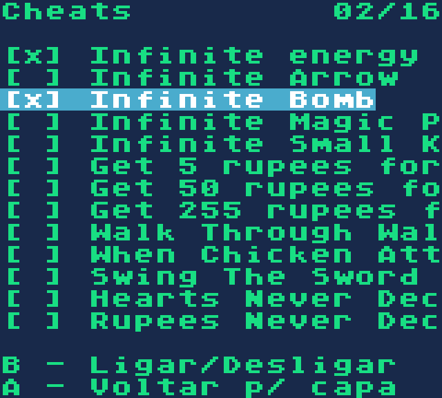

Each line has a Game Genie code with its description. **B** toggles the cheat (`[x]` is on); the counter at the top shows how many are on. **A** goes back to the cover, which then shows the total that is on. When you press **B** on the cover, the menu loads the ROM, applies the ticked cheats and only then starts the game.

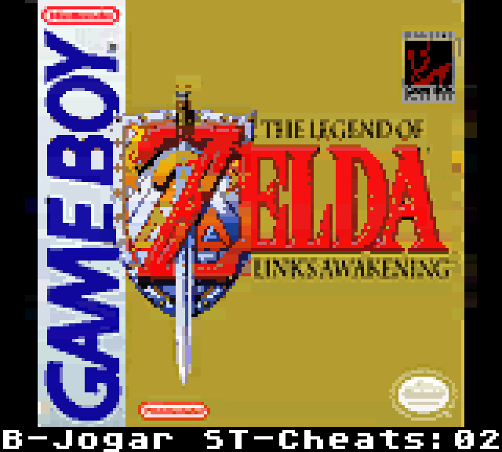

### The SELECT menu

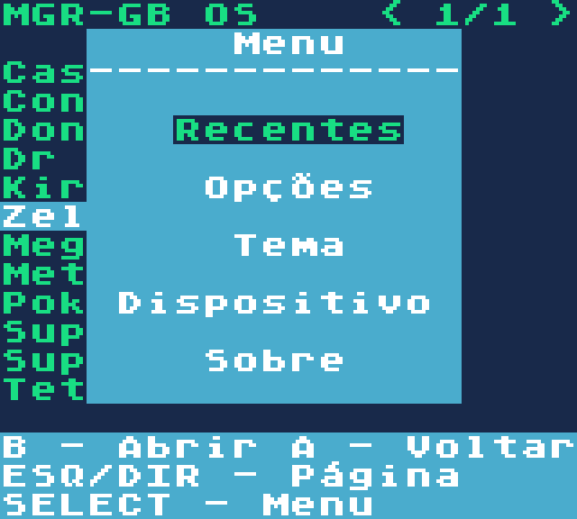

- **Recentes (Recents):** the last 6 games.
- **Opções (Options):** loading settings for the selected game (mapper, ROM and RAM size, save).
- **Tema (Theme):** picks one of the 6 themes; the choice is kept in `EDGB\SETUP.BIN`.
- **Dispositivo (Device):** system information.
- **Sobre (About):** version and keys.

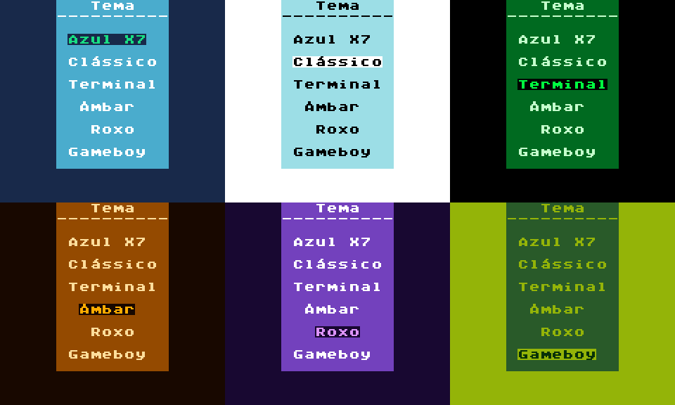

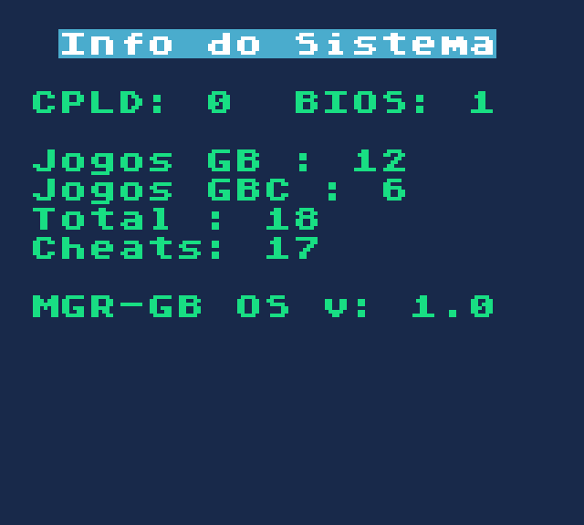

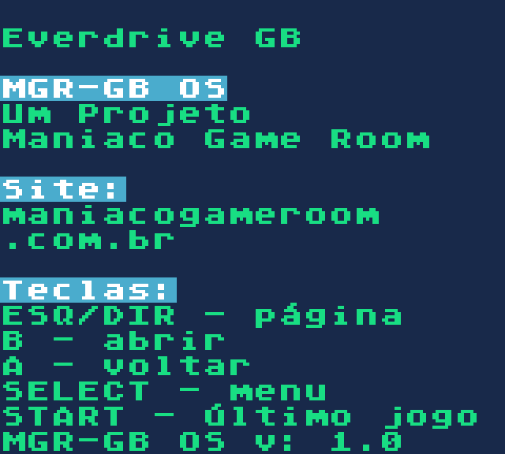

## 8. Limits

- **Game Genie only** (`XXX-XXX` or `XXX-XXX-XXX`), one entry = one code. GameShark and `+` combinations are left out. The menu finds the memory bank by the compare byte, so only 9-digit codes that match the ROM (or 6-digit ones in bank 0) are included.
- Approximate name matching (marked "approximate") can be wrong: check it. Converting a cheat does not prove it works on that game version.
- Accepts `.gb`, `.gbc` and `.sgb` (loose or in `.zip`) up to 8 MiB.
- Above **~780 entries in one folder** the menu stops showing the preview; that is why the program creates subfolders above 700 games.
- `PREVIEW.PCK` has 2,064 slots; a game with no slot has no preview (it appears in the warning).
- `PREVIEW.PCK` must be **contiguous** on the card. The program reserves its size before writing, but Windows only lets an administrator check the layout; if the preview does not show, copy the files to a freshly formatted (FAT32) card.
- On a plain Game Boy the cover screen is ignored.

## 9. Common problems

- **The preview does not show in the list:** see the `PREVIEW.PCK` limit above; check that the folder has fewer than ~780 entries.
- **A game is out of alphabetical order:** use **Reorder folders…**.
- **I want the original menu back:** rename `GBOS_ORIG.BAK` to `GBOS.GB`.
- **The card acted strange after I pulled it out:** always use **Safely remove**; the project's card has corrupted twice without it. If it repeats, replace the card.

Questions or problems: open an [Issue](../../issues).
