# Manual do MGR-GB OS

**[English](MANUAL.en.md)** · [Voltar ao README](README.md)

Este manual mostra, tela por tela, como preparar o cartão com o **MGR-GB OS · Gerenciador** e como usar o menu no console.

## 1. Antes de começar

1. Você precisa de um **EverDrive GB** com o sistema GBOS (testado no **EverDrive GB Extreme**, placa EXTREME REV.E) e de um cartão microSD em **FAT32**.
2. O pacote **não traz ROMs, capas nem cheats**: as ROMs são as suas; capas e cheats o programa baixa na primeira vez.
3. Faça **uma cópia do conteúdo do cartão** antes da primeira gravação. O programa não apaga nada e guarda backup do que troca, mas o cartão é seu e vale ter um backup à parte.
4. Depois de gravar, use **Remover com segurança** no Windows antes de tirar o cartão.

## 2. Abrindo o programa

Abra **`MGR-GB-OS-Gerenciador.exe`** (um arquivo só, não precisa instalar). O menu do topo tem **Arquivo**, **Tema** (aparência do programa), **Idioma / Language** (português ou English; o menu que o programa grava no cartão acompanha esse idioma) e **Ajuda**. À esquerda ficam as cinco páginas: **Game Boy**, **Game Boy Color**, **Tema**, **Sistema** e **Gravar no cartão**.

**Atualizações:** ao abrir, o programa consulta as Releases do GitHub; se houver versão mais nova, aparece um aviso na barra lateral com as novidades e o botão **Baixar e atualizar**. Ele confere o SHA-256, guarda o `.exe` atual como `.exe.anterior` e reabre já atualizado. Dá para desligar a consulta em **Ajuda > Verificar ao abrir o programa** ou consultar na hora em **Ajuda > Verificar atualizações…**.

## 3. As páginas Game Boy e Game Boy Color

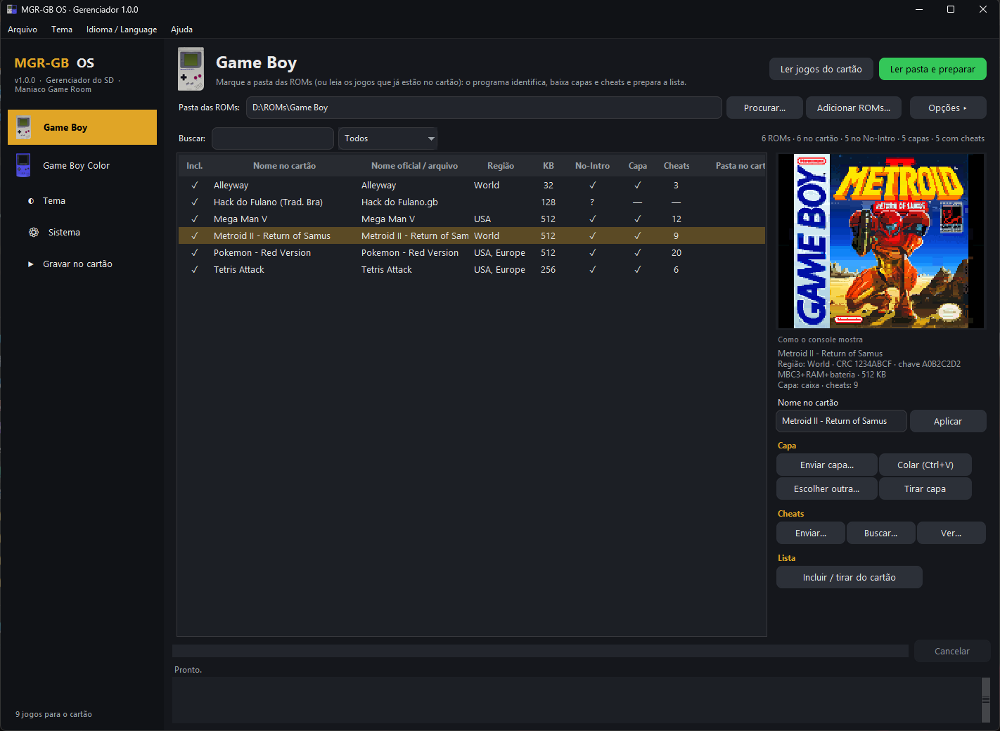

1. Em **Pasta das ROMs**, clique em **Procurar…** e escolha a pasta (a mesma pode servir aos dois consoles: o programa separa pelo cabeçalho de cada ROM). **Adicionar ROMs…** acrescenta arquivos soltos.
2. Clique em **Ler pasta e preparar**. O programa:
   - identifica cada jogo pelo **conteúdo** (CRC32 contra o banco No-Intro), inclusive ROMs dentro de `.zip`;
   - mantém **pastas e nomes originais**, inclusive revisões e cópias idênticas em caminhos diferentes (modo padrão); a seleção por região/revisão fica nos outros modos de organização;
   - baixa a **capa** (caixa, senão tela de título, senão captura) e os **cheats** pelo nome oficial.
3. A tabela mostra, por jogo: se está **incluído**, o **nome no cartão**, o nome oficial, a região, o tamanho, se foi reconhecido no No-Intro, se tem capa e quantos cheats. Use **Buscar** e o filtro (incluídos, excluídos, sem capa, sem cheats, fora do No-Intro). Clique duas vezes numa linha para incluir ou tirar o jogo da gravação.
4. No painel da direita, para o jogo selecionado:
   - **Nome no cartão:** o que a lista do console vai mostrar; **Aplicar** grava a mudança nos modos de organização; na preservação vale o nome original do arquivo.
   - **Capa:** **Enviar capa…** (arquivo), **Colar (Ctrl+V)**, **Escolher outra…** ou **Tirar capa**.
   - **Cheats:** **Enviar…** o seu `.cht`, **Buscar…** de novo ou **Ver…** e tirar códigos.
   - **Incluir / tirar do cartão.**
5. **Opções ▸** controla o nome dos arquivos no cartão, a região preferida, as pastas do cartão, se descarta dumps ruins, se inclui hacks e traduções fora do No-Intro e se baixa capas e cheats ao ler a pasta.

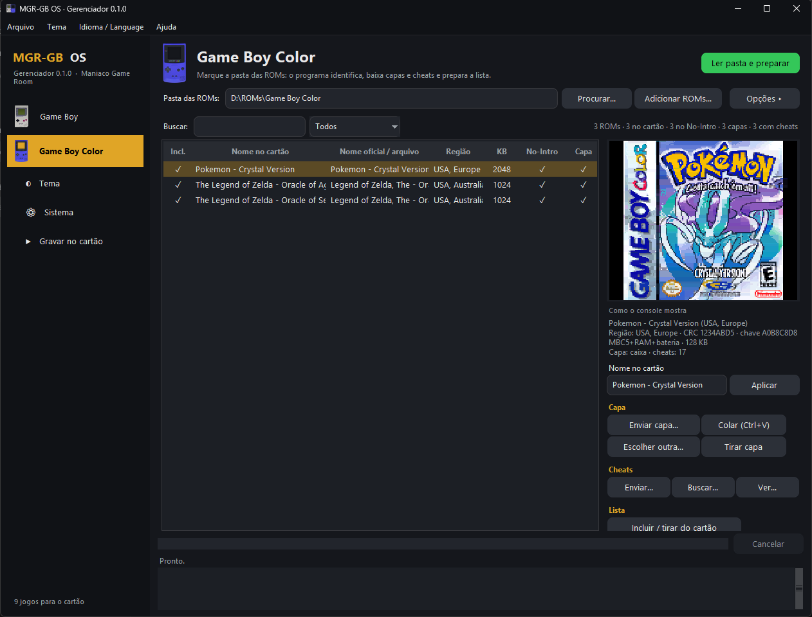

A página **Game Boy Color** é igual, para os jogos `.gbc`. **Arquivo > Salvar projeto** guarda a lista num `.mgrgb.json` (ele aponta para as suas ROMs, não as incorpora).

### Cartão que já tem jogos

Se o cartão já está cheio, use **Ler jogos do cartão** (nas páginas Game Boy e Game Boy Color). O programa lê as ROMs de **todas as pastas e subpastas**, inclusive árvores como `Roms/Game Boy/GB US/` (menos `EDGB`, `COVERS` e `CHEATS`; `.zip` não), separa Game Boy e Game Boy Color pelo cabeçalho, **mantém cada jogo onde está e sem renomear**, e baixa as capas e os cheats. Depois, **Gravar no cartão** só acrescenta capas, cheats, a prévia e o menu. As subpastas também ganham a imagem do console e a contagem dos jogos descendentes. A reordenação das pastas é opcional e começa desligada. Numa biblioteca grande a primeira conversão das capas demora (milhares de capas levam cerca de uma hora no conversor melhorado; o conversor **Padrão** é bem mais rápido).

### Atualizando para a 1.0.1

Escolha a **raiz do cartão**, use **Ler jogos do cartão** e mantenha **Instalar / atualizar o MGR-GB OS ao gravar no cartão** marcado. Grave o plano para preparar o OS e os índices das pastas juntos; trocar só `GBOS.GB` não basta. Entradas antigas dos Recentes sem chave abrem sem extras; abrir o jogo pela pasta registra a chave nova.

### Escolher outra capa

**Escolher outra…** abre uma janela com busca pelo nome e a lista das imagens disponíveis (caixa, título, captura). Ao clicar numa opção você vê a **imagem original** e, em seguida, **como o console a mostra**. Dois cliques escolhem.

## 4. A página Tema

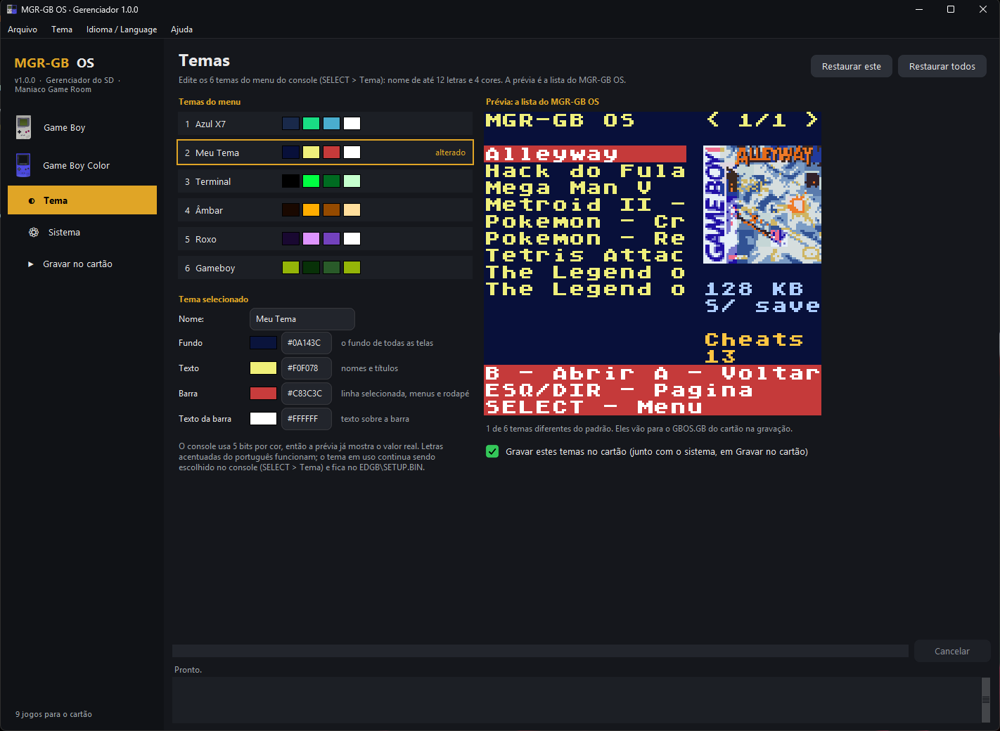

O menu do console tem **6 temas** (SELECT > Tema). Aqui você edita cada um: **nome de até 12 letras** (acentos funcionam) e **4 cores** (fundo, texto, barra e texto da barra). A prévia ao lado é a **lista real do MGR-GB OS**, desenhada com a fonte do console e uma capa de jogo, e muda enquanto você mexe nas cores. O console usa 5 bits por cor, então a prévia já mostra o valor real. **Restaurar este** e **Restaurar todos** voltam ao padrão.

Os temas vão para o menu na gravação (marque *Gravar estes temas no cartão*). O programa só troca **dados** (cores, nomes e a tabela de ponteiros), nunca código do menu. O tema **em uso** continua sendo escolhido no console e fica em `EDGB\SETUP.BIN`, que o programa nunca toca. Limite: 6 temas ao mesmo tempo.

## 5. A página Sistema

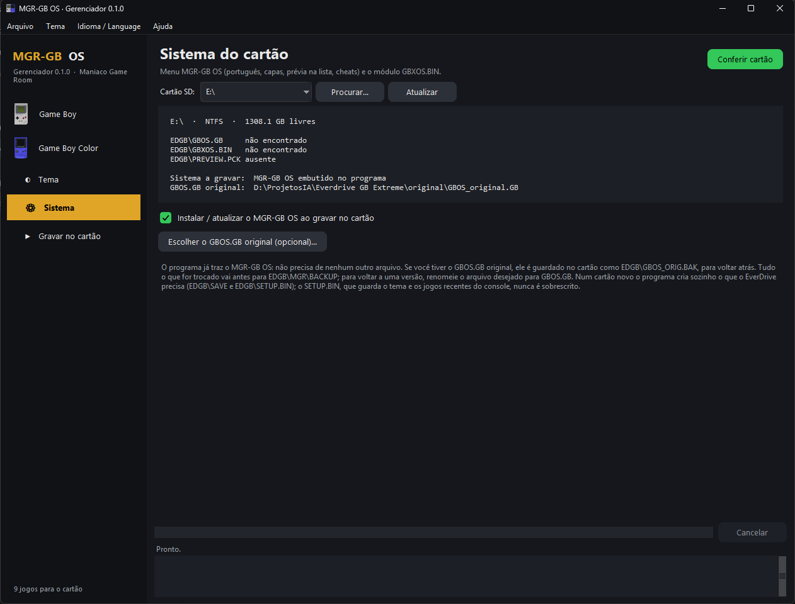

Escolha a unidade do cartão (**Procurar…** ou **Atualizar**) e clique em **Conferir cartão** para ver o que há nele. Deixe marcado *Instalar / atualizar o MGR-GB OS ao gravar no cartão* para o programa colocar o menu (`EDGB\GBOS.GB` e `EDGB\GBXOS.BIN`). O programa já traz o MGR-GB OS pronto, então não precisa de nenhum outro arquivo. Se você tiver o `GBOS.GB` original da Krikzz (no cartão ou escolhido em **Escolher o GBOS.GB original (opcional)…**, SHA-256 `a4f92e99…66ae`), ele é guardado em `EDGB\GBOS_ORIG.BAK` para você poder voltar.

Para voltar a uma versão do menu, renomeie o arquivo desejado (`GBOS_ORIG.BAK` ou uma cópia em `EDGB\MGR\BACKUP\<data>`) para `GBOS.GB`.

## 6. A página Gravar no cartão

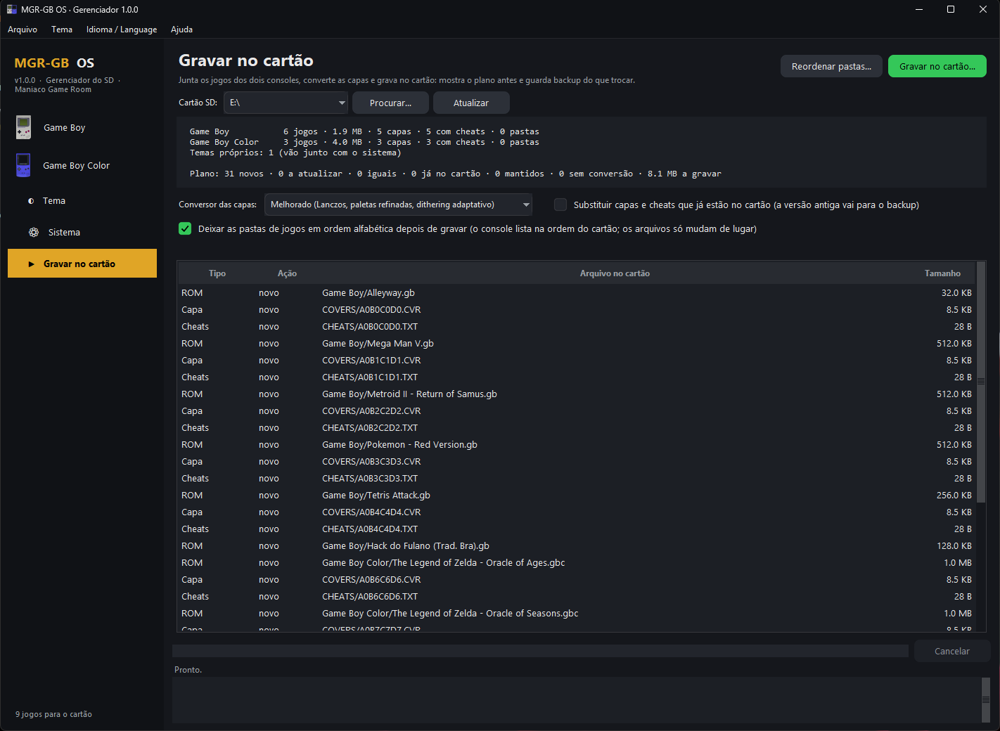

1. Escolha o cartão e o **conversor das capas**: **Melhorado** (padrão) ou **Padrão**.
2. Marque, se quiser, *Substituir capas e cheats que já estão no cartão* (a versão antiga vai para o backup) e *Deixar as pastas de jogos em ordem alfabética depois de gravar* (desligado por padrão para preservar a estrutura existente).
3. Clique em **Gravar no cartão…**. O programa converte as capas (o rodapé mostra quantas foram e **quanto falta**, refeito pelo ritmo real), monta o **plano** e mostra a tabela com cada arquivo: tipo, ação (novo, atualizar, igual…), caminho no cartão e tamanho.
4. Confirme com **Sim**. Só então o programa grava.

### O que é gravado no cartão

| No cartão | O quê |
|---|---|
| Caminhos originais da coleção | ROMs nos caminhos originais no modo de preservação. Outros modos podem organizar em `Game Boy\` e `Game Boy Color\` |
| `COVERS\<chave>.CVR` | a capa grande colorida. O app atribui a chave pelo conteúdo da ROM; originais e hacks com o mesmo cabeçalho ficam separados |
| `CHEATS\<chave>.TXT` | cheats Game Genie (até 28 por jogo) |
| `MGRPREV.PCK` em cada pasta de jogos e suas pastas superiores | prévia da lista, nomes completos e chaves dos extras; 2 MiB por pasta indexada, aceita fragmentação |
| `EDGB\MGR\ASSETS.JSON` e `EDGB\COUNTS.BIN` | chaves persistentes por conteúdo e contagens de todas as subpastas |
| `EDGB\GBOS.GB` e `EDGB\GBXOS.BIN` | o menu MGR-GB OS e o módulo dele |
| `EDGB\SAVE\` e `EDGB\SETUP.BIN` | o que o menu precisa num cartão novo (pasta dos saves; tema e recentes), criados só se faltarem |
| `EDGB\GBOS_ORIG.BAK` | o GBOS original, se você o tiver |
| `EDGB\MGR\BACKUP\<data>\` e `EDGB\MGR\DIARIO\` | o que foi trocado e o diário de cada gravação |

### Regras de segurança

- **Nada é apagado do cartão.** O programa só acrescenta e atualiza.
- Tudo o que for substituído vai antes para `EDGB\MGR\BACKUP\<data>`. Cada arquivo é gravado num temporário, forçado para o disco, trocado e **conferido depois**.
- **ROM nunca é sobrescrita:** a preservação interrompe o plano se o destino original tiver outro conteúdo. Nos outros modos, usa um nome como `Nome (2).gb`. ROM que já está no cartão não é copiada de novo.
- Capas e cheats que já estão no cartão **ficam como estão**, a não ser que você peça para substituir.
- O menu (`GBXOS.BIN` e `GBOS.GB`) é o **último passo**; se o segundo arquivo falhar, o primeiro volta ao que era.
- Antes de gravar, o programa confere: cartão **FAT32**, espaço livre e se a unidade é removível (disco fixo pede confirmação). Um cartão novo e vazio é normal: o programa cria sozinho o que o EverDrive precisa.
- `EDGB\SETUP.BIN` é criado **só se faltar** e, depois de existir, **nunca é tocado**.

### Capas: conversão e cache

As capas são baixadas do libretro-thumbnails e **convertidas no seu PC** (em vez de vir um pacote pronto: a arte é dos respectivos titulares, e a prévia da lista depende do nome do arquivo e dos cheats de cada coleção). Cada capa leva cerca de 13 s de um núcleo, e várias rodam em paralelo. O resultado fica em `%LOCALAPPDATA%\MGR-GB-OS\conversao`, então só a primeira gravação é demorada (**Ajuda > Limpar o cache**).

### Ordem dos jogos na lista

O menu **não ordena**: ele lista os arquivos na ordem das entradas do diretório do cartão. Por isso o programa grava as ROMs **em ordem alfabética** (sem diferença de maiúsculas, números por valor), direto no nome final.

**Reordenar pastas…** deixa em ordem um cartão que já tem jogos: **Game Boy**, **Game Boy Color**, as subpastas e as duas pastas na raiz. Para cada pasta fora de ordem, as entradas são **movidas** (renomear no mesmo cartão, sem copiar dados) para `EDGB\MGR\REORDENAR` e voltam em ordem. Antes de mexer nos jogos o programa **prova o mecanismo numa pastinha de teste** no próprio cartão; um diário permite **devolver tudo** se a operação for interrompida; no fim a ordem real é conferida. **Nada é apagado.** Não tire o cartão enquanto roda (leva alguns segundos).

## 7. No console

### A lista de jogos

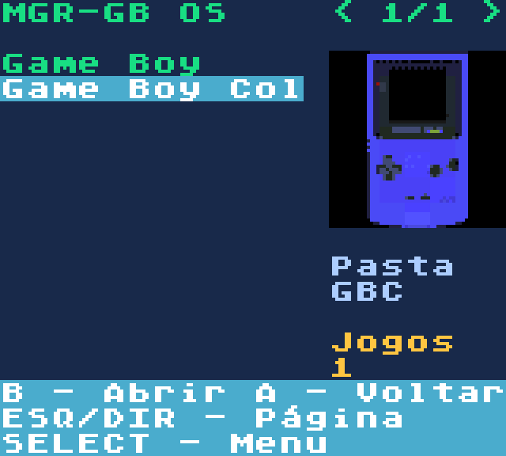

Na raiz aparecem as pastas originais da coleção (ou **Game Boy** e **Game Boy Color** nos modos de organização), com a imagem do console e a contagem de jogos. **B** abre a pasta.

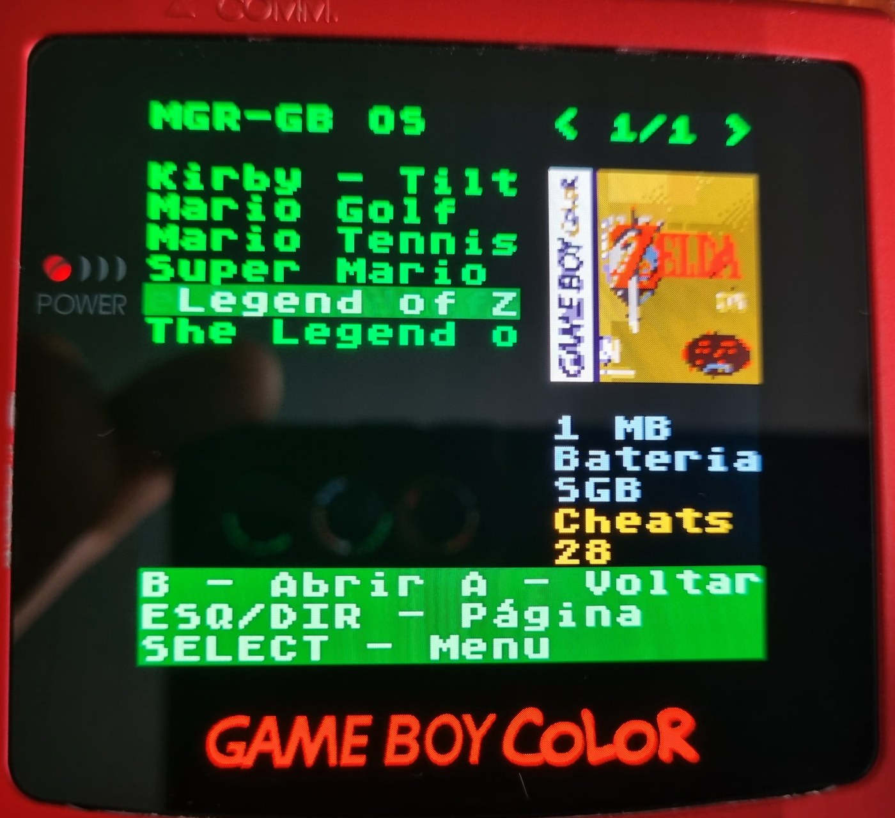

- **Cima e baixo:** escolhem o jogo. Ao parar num jogo, a **prévia** aparece à direita: capa pequena, tamanho da ROM, **Bateria** ou "S/ save", marcas **RTC** e **SGB**, e a quantidade de **Cheats** (em âmbar; "Sem cheats" apagado quando não há).
- **Esquerda e direita:** mudam de página.
- **B:** abre a capa do jogo (ou inicia o jogo, se ele não tem capa).
- **A:** volta uma pasta.
- **START:** volta ao último jogo.
- **SELECT:** abre o menu.

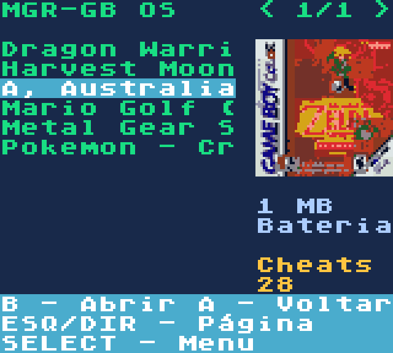

### A capa

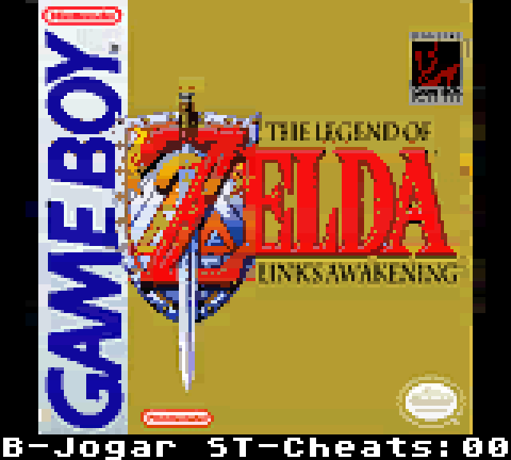

A capa ocupa a tela com cerca de 600 cores. No rodapé: **B-Jogar** e **ST-Cheats:NN** (quantos cheats estão ligados). **B** inicia o jogo; **START** abre os cheats; **SELECT** volta à lista.

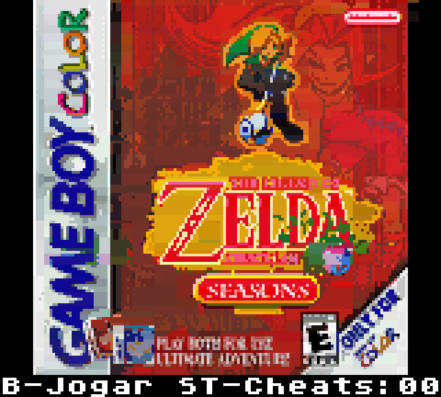

### Os cheats

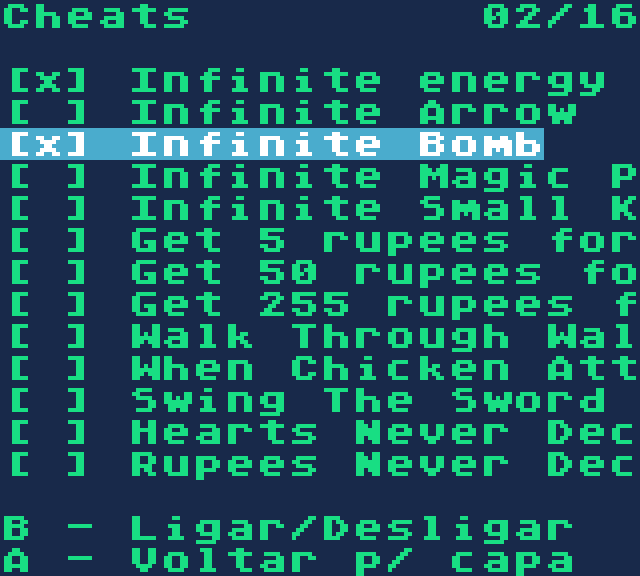

Cada linha traz um código Game Genie com a sua descrição. **B** liga ou desliga o cheat (`[x]` ligado); o contador no topo mostra quantos estão ligados. **A** volta para a capa, que passa a mostrar o total ligado. Ao apertar **B** na capa, o menu carrega a ROM, aplica os cheats marcados e só então inicia o jogo.

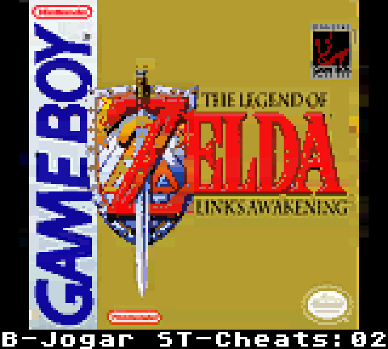

### O menu SELECT

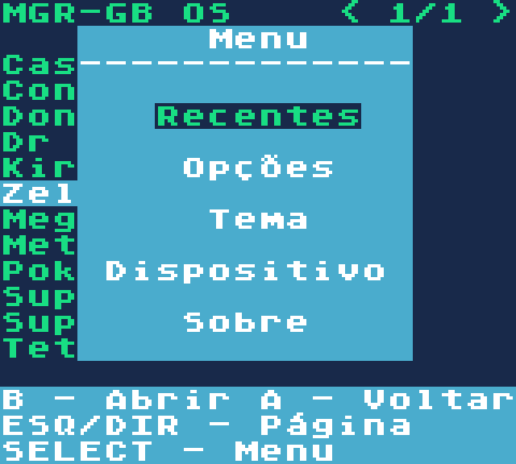

- **Recentes:** os últimos 6 jogos.
- **Opções:** ajustes de carregamento do jogo selecionado (mapper, tamanho da ROM e da RAM, salvar).
- **Tema:** escolhe um dos 6 temas; a escolha fica em `EDGB\SETUP.BIN`.
- **Dispositivo:** informações do sistema.
- **Sobre:** versão e teclas.

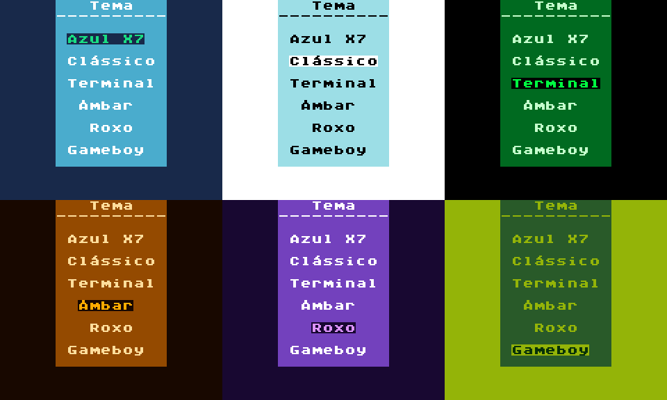

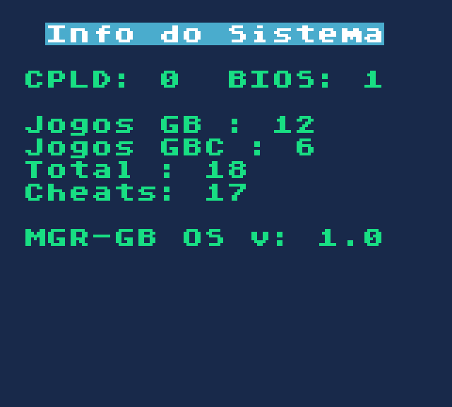

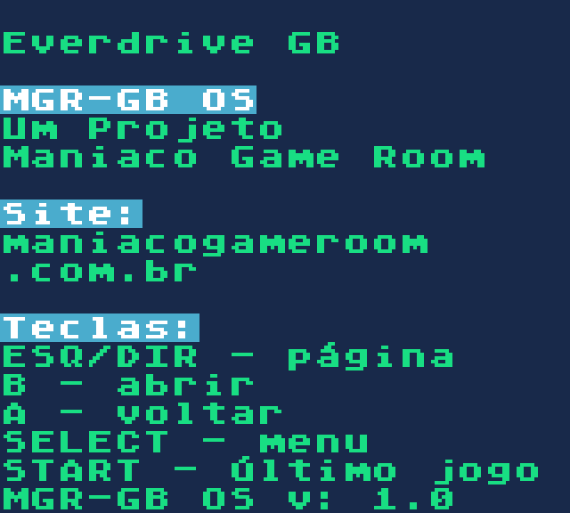

## 8. Limites

- **Só Game Genie** (`XXX-XXX` ou `XXX-XXX-XXX`), uma entrada = um código. GameShark e combinações com `+` ficam de fora. O menu procura o banco de memória pelo byte de comparação, então só entram códigos de 9 dígitos que batem com a ROM (ou de 6 dígitos no banco 0).
- O casamento aproximado de nome (marcado "aproximada") pode errar: confira. Converter um cheat não prova que funciona naquela versão do jogo.
- Aceita `.gb`, `.gbc` e `.sgb` (soltos ou em `.zip`) até 8 MiB.
- Acima de **~780 entradas numa pasta** o menu deixa de mostrar a prévia; o modo de organização automática cria subpastas passando de 700 jogos. A preservação não divide as pastas existentes.
- Cada pasta tem seu `MGRPREV.PCK` (2.048 vagas no índice). Não há uma única tabela de prévias para a coleção inteira. O OS segue a cadeia FAT, inclusive em índices fragmentados.

- Num Game Boy sem cores, a tela de capa é ignorada.

## 9. Problemas comuns

- **A prévia não aparece na lista:** prepare o cartão pelo app 1.0.1 com a atualização do OS habilitada; confira se a pasta tem menos de ~780 entradas.
- **Jogo fora da ordem alfabética:** use **Reordenar pastas…**.
- **Quero voltar ao menu original:** renomeie o `GBOS_ORIG.BAK` para `GBOS.GB`.
- **O cartão ficou estranho depois de tirá-lo:** use sempre **Remover com segurança**; o cartão do projeto já corrompeu duas vezes sem isso. Se repetir, troque o cartão.

Dúvidas ou problemas: abra uma [Issue](../../issues).
