# MGR-GB OS

**[Português](README.md)**

**A Brazilian Portuguese menu for the EverDrive GB, with a color cover for every game, a preview in the list, ready-made cheats and themes — plus a Windows app that gets the SD card ready in a few clicks.**

A **[Maniaco Game Room](https://www.maniacogameroom.com.br/)** project.

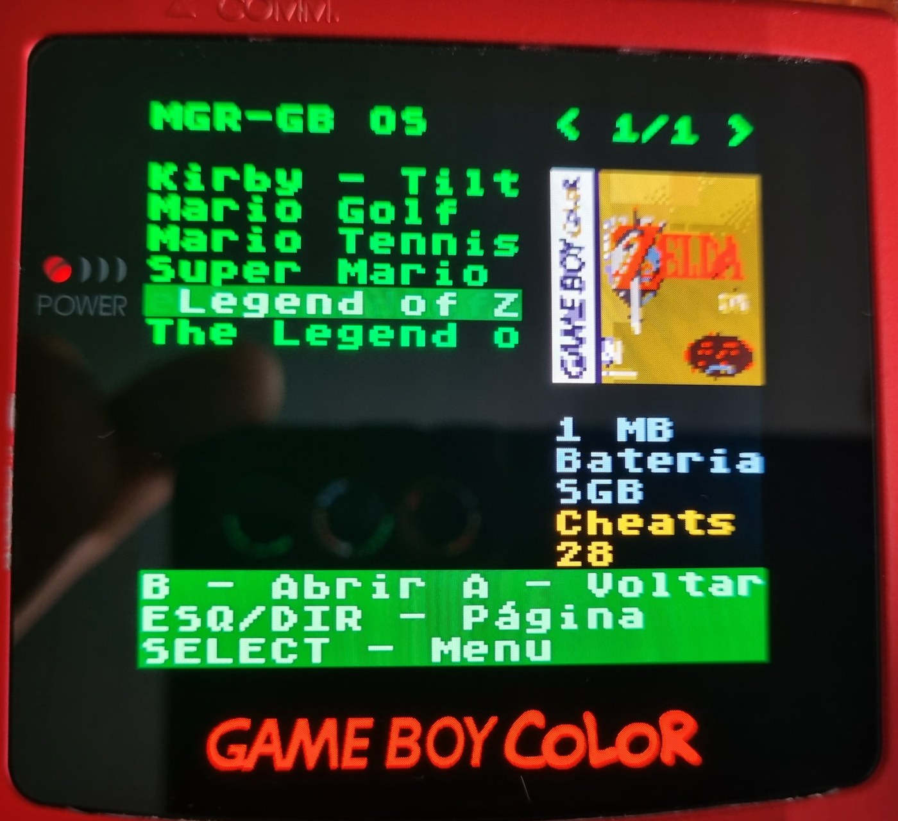

*The game list on a Game Boy Color, with the EverDrive GB Extreme.*

> **Tested on real hardware:** a Game Boy Color with the **EverDrive GB Extreme** cartridge (EXTREME REV.E board, microSD in FAT32). See [What was tested](#what-was-tested).

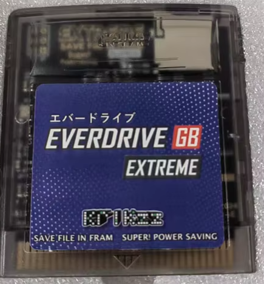

*The cartridge used in the tests.*

## New in 1.0.1

- **Folders and subfolders preserved:** reads collections such as `Roms/Game Boy/GB US/` and keeps names, revisions and every copy at their original paths. A mixed source fills the GB and GBC pages in one pass.
- **Covers and cheats for the correct version:** different contents, such as an original and a hack sharing a header, receive separate keys. Each folder's preview uses the complete file name.
- **Large collections:** folder indexes, reads that follow fragmented card files, and cover/cheat lookup beyond the first 1,024 entries. Device Info counts games in all subfolders; Recent keeps the correct asset key.
- **Preservation by default:** the initial mode is **Keep original folders and names**; reordering is optional. Cheats without available cover art get the console image to open the code screen.

**Updating an existing card:** pick the card root, click **Read games from the card**, keep **Install / update MGR-GB OS when writing to the card** enabled and write. The app prepares the indexes and compatible OS together; replacing only `GBOS.GB` is not enough.

Validation: 4,234 files checked with paths and contents preserved, 98 automated tests, PT/EN emulator checks and the executable self-test. The user confirmed the version works; not every title was played.

## What MGR-GB OS brings

| | |
|---|---|
| 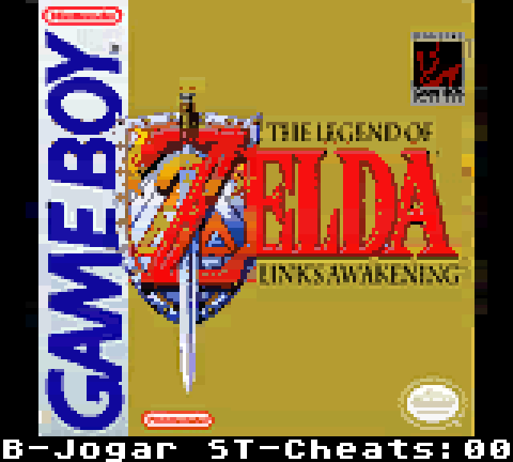 | 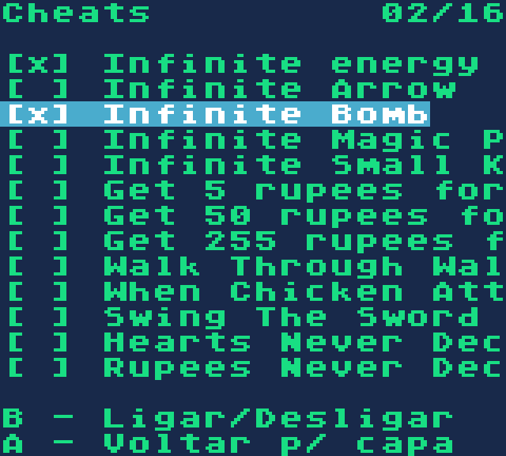 |
| 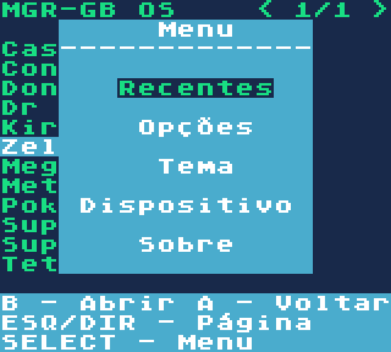 | 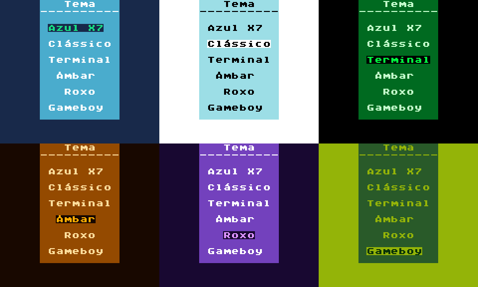 |

- **The whole menu in Portuguese** (with accented characters á, ã, ç, é…) **or in English**: the menu written to the card follows the app's language.
- **Preview in the list:** beside the name you see the game's small cover, the ROM size, whether it has **battery**, **RTC** or **SGB**, and how many **cheats** exist.
- **Large color cover:** **B** on a game opens the cover full screen, with about 600 colors (the menu changes the console's colors line by line). **B** again starts the game.
- **Per-game cheats, with descriptions:** **START** on the cover opens the list; **B** toggles each code (Game Genie, up to 28 per game) and the menu applies them when the game starts.
- **Six themes** (SELECT > Theme): Azul X7, Clássico, Terminal, Âmbar, Roxo and Gameboy. All can be edited in the app (name and 4 colors).
- **Recents:** the last 6 games played; **START** in the list goes back to the last one.
- **Clean list:** no file extensions, long names scroll on the selected row, system folders (`EDGB`, `COVERS`, `CHEATS`) hidden.
- **Device screen:** how many Game Boy and Game Boy Color games are on the card and how many have cheats.

| | |
|---|---|
| 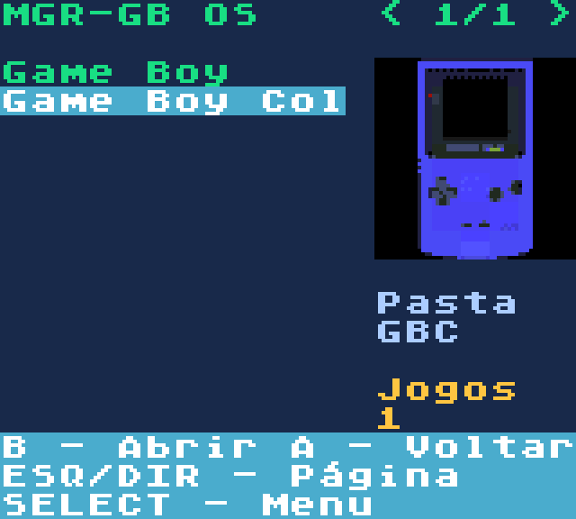 | 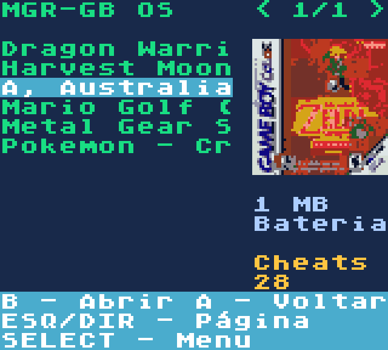 |
| 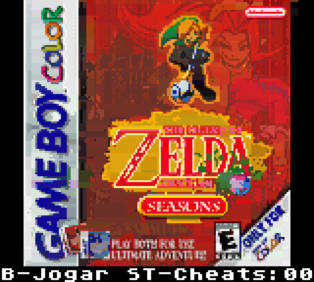 | 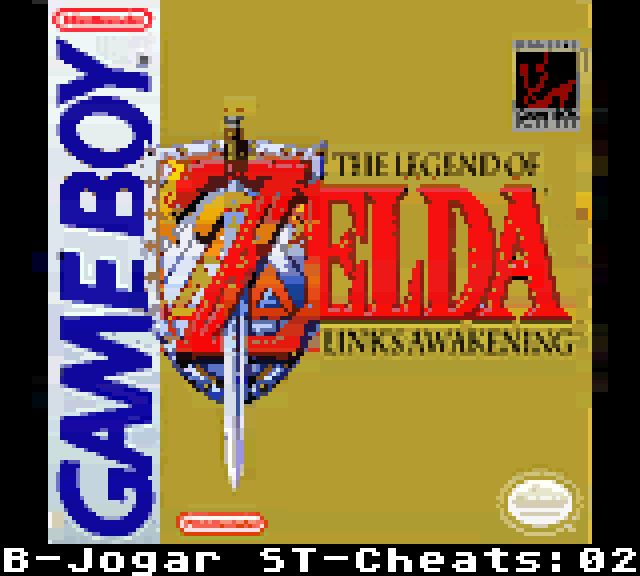 |

## The app: MGR-GB OS · Manager

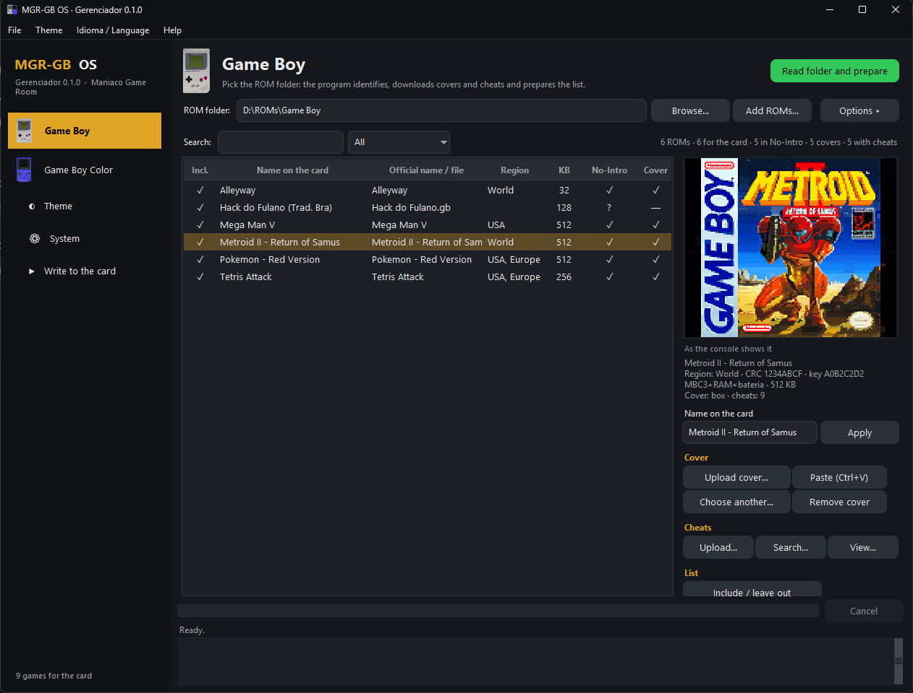

With the card in your PC:

1. **identifies each ROM by content** (CRC32 against the No-Intro database), also reads ROMs inside `.zip` files and keeps all copies in the default preservation mode;
2. **downloads the cover and the cheats** by official name and converts the cover to the console format on your computer;
3. lets you check the list: **upload your own cover**, **choose another one** (with a preview of how the console shows it), upload your own `.cht`, edit the name on the card and include or leave out games;
4. shows the **plan file by file** and only writes after your "yes";
5. installs **MGR-GB OS** and writes the themes you edited;
6. optionally puts the folders in **alphabetical order** (the menu lists games in the card's order);
7. if the card **already has games**, the **Read games from the card** button reads all folders and subfolders without touching the files and only adds covers, cheats, preview and the menu.

The app works in **Portuguese or English** (Idioma / Language menu), and the console menu comes out in the same language: switch the language and just write again (the program tells you the card's menu is in another language). **Nothing is deleted from the card:** whatever is replaced goes to a backup folder, and every file is verified after writing.

| | |
|---|---|
| 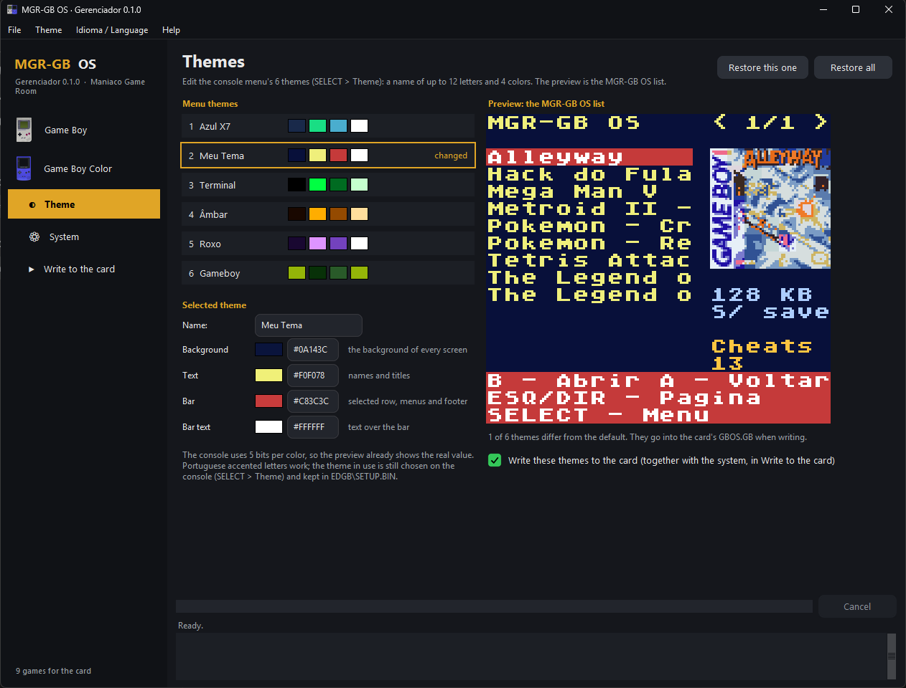 | 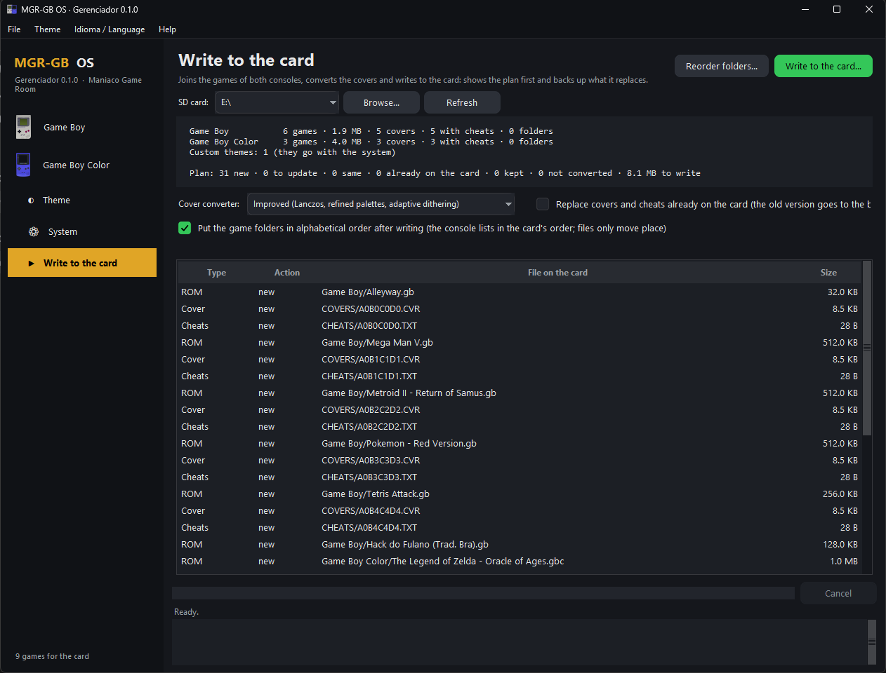 |

## How to use

1. Download **`MGR-GB-OS-Gerenciador.exe`** from the **[Releases](../../releases)** page (a single file, no installation).
2. Put the EverDrive's card in your PC, formatted as **FAT32**.
3. Open `MGR-GB-OS-Gerenciador.exe`, pick the root folder of your ROM collection in **Keep original folders and names** mode, and click **Read folder and prepare**.
4. On **Write to the card**, pick the drive and click **Write to the card…**, check the plan and confirm.
5. Use **Safely remove** in Windows, put the card in the EverDrive and turn the console on.

The app **updates itself**: on startup it tells you if a newer version is on the Releases and swaps the `.exe` with one click (Help > Check for updates…).

Full step by step, with every screen: **[Manual](MANUAL.en.md)**.

## Requirements

- An **EverDrive GB** cartridge running the GBOS system (tested on the **EverDrive GB Extreme**, EXTREME REV.E board). Menus of other models were not tested.
- Windows 10 or 11.
- A microSD card in **FAT32**.
- Internet the first time (covers and cheats are downloaded, converted and kept on the PC; the first write of a large library takes time, about half an hour for ~1,000 covers).
- **Color covers show only on a console with colors** (Game Boy Color). On a plain Game Boy the menu ignores the cover screen.

## What was tested

| Item | Where |
|---|---|
| Writing the card with the app (games, covers, cheats, preview, menu) and the list with the preview | **Game Boy Color + EverDrive GB Extreme**, FAT32 card |
| Alphabetical order inside the folders and of the two root folders | **Game Boy Color + EverDrive GB Extreme**, FAT32 card |
| Going back with **A** in the list without “garbage characters” in the preview (menu fix) | **Game Boy Color + EverDrive GB Extreme** |
| Plain Game Boy (DMG), other EverDrive GB models | Not tested |

The photo of the game list (at the top) is from the **real console**. The other screens were generated in the **project's own emulator** (which runs the real menu), with ROMs cut down just for the list; they are not photos of the console.

## Notice

**MGR-GB OS is derived from GBOS**, the EverDrive GB system by Igor Golubovskiy (Krikzz): it is GBOS with translations, covers, preview, cheats and themes added. The app already carries the finished menu; **this project is not affiliated with Krikzz** and the rights to the original code remain with the author. See **[TERCEIROS.md](TERCEIROS.md)**. ROMs are not provided; covers and cheats are downloaded from the libretro projects and belong to their owners.

## Credits

- GBOS and EverDrive GB: **Krikzz** — [krikzz.com](https://krikzz.com)
- Covers: [libretro-thumbnails](https://github.com/libretro-thumbnails) (the art belongs to the respective owners)
- Cheats and game database (No-Intro): [libretro-database](https://github.com/libretro/libretro-database)

## License

**Freeware — free to use. © 2026 Maniaco Game Room. All rights reserved.** See the [license](LICENCA.md) and the [third-party components](TERCEIROS.md).

Found a problem? Open an [Issue](../../issues).
