# MGR-GB OS

**[English](README.en.md)**

**Menu do EverDrive GB em português, com a capa colorida de cada jogo, prévia na lista, cheats prontos e temas — e um aplicativo para Windows que deixa o cartão SD pronto em poucos cliques.**

Um projeto **[Maniaco Game Room](https://www.maniacogameroom.com.br/)**.

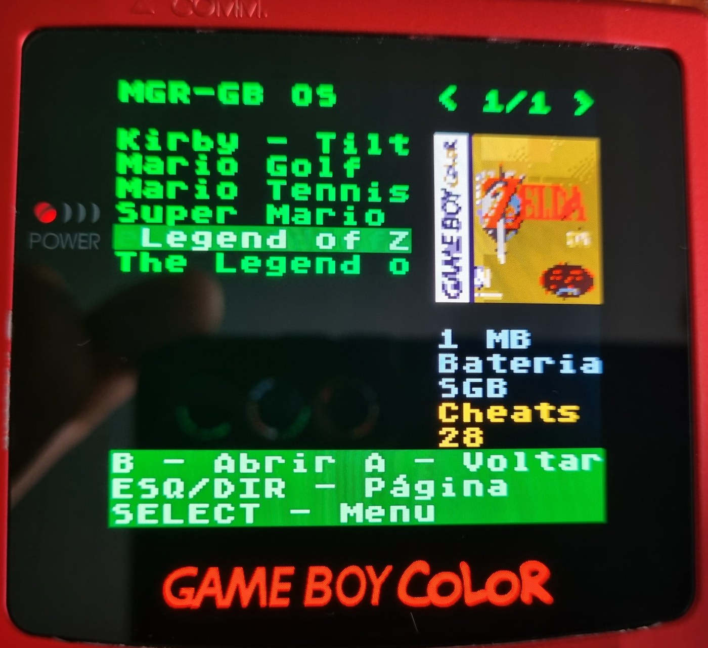

*A lista de jogos no Game Boy Color, com o EverDrive GB Extreme.*

> **Testado em hardware real:** Game Boy Color com o cartucho **EverDrive GB Extreme** (placa EXTREME REV.E, microSD em FAT32). Veja [O que foi testado](#o-que-foi-testado).

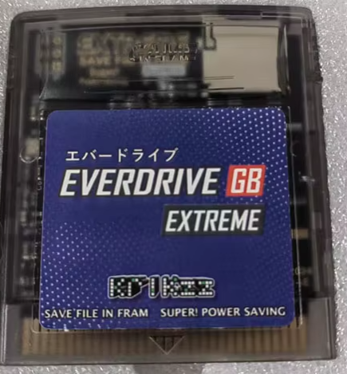

*O cartucho usado nos testes.*

## O que o MGR-GB OS traz

| | |
|---|---|
| 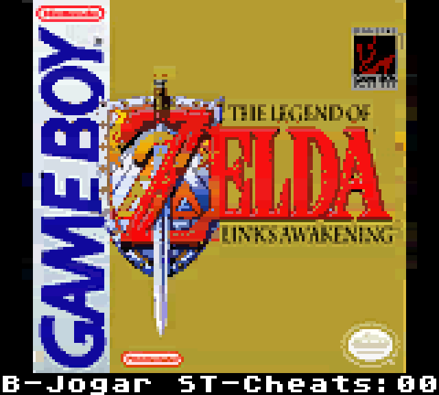 | 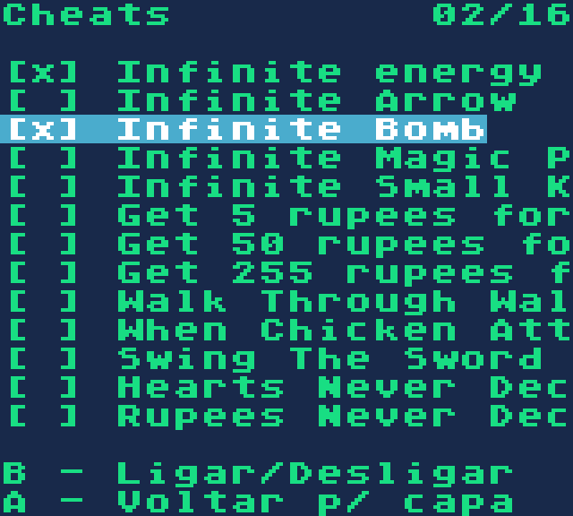 |
| 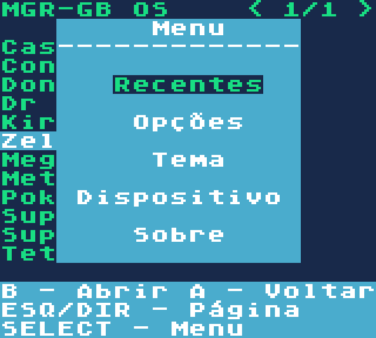 | 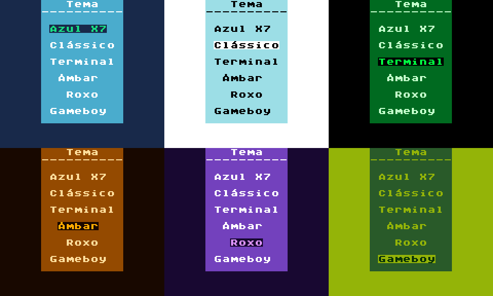 |

- **Menu inteiro em português**, com acentos (á, ã, ç, é…), ou **em inglês**: o menu que vai para o cartão acompanha o idioma do aplicativo.
- **Prévia na lista:** ao lado do nome aparece a capa pequena do jogo, o tamanho da ROM, se tem **bateria**, **RTC** ou **SGB** e quantos **cheats** existem.
- **Capa grande colorida:** **B** no jogo abre a capa em tela cheia, com cerca de 600 cores (o menu troca as cores do console linha a linha). **B** de novo inicia o jogo.
- **Cheats por jogo, com descrição:** **START** na capa abre a lista; **B** liga e desliga cada código (Game Genie, até 28 por jogo) e o menu os aplica ao iniciar o jogo.
- **Seis temas** (SELECT > Tema): Azul X7, Clássico, Terminal, Âmbar, Roxo e Gameboy. Todos podem ser editados pelo aplicativo (nome e 4 cores).
- **Recentes:** os últimos 6 jogos jogados; **START** na lista volta ao último.
- **Lista limpa:** sem a extensão do arquivo, nome comprido rola na linha selecionada, pastas do sistema (`EDGB`, `COVERS`, `CHEATS`) ocultas.
- **Tela Dispositivo:** quantos jogos de Game Boy e de Game Boy Color há no cartão e quantos têm cheats.

| | |
|---|---|
| 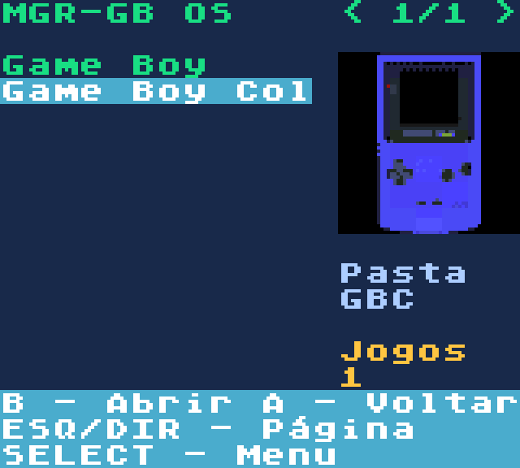 | 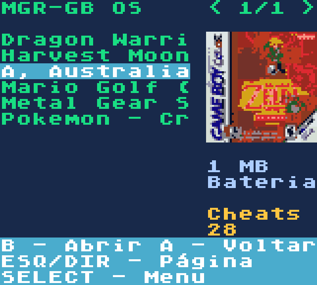 |
| 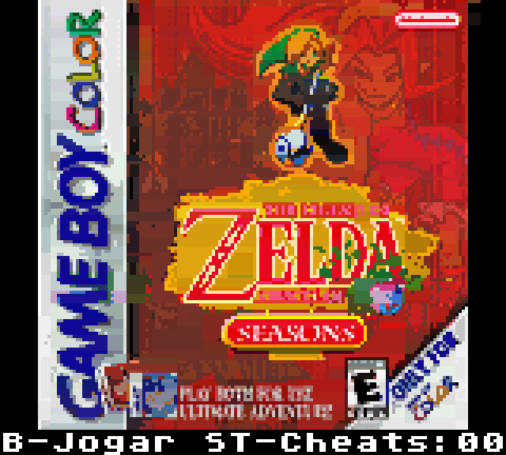 | 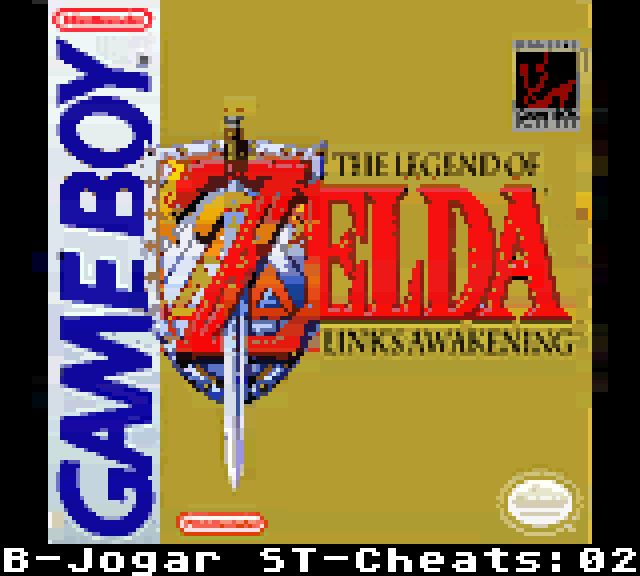 |

## O aplicativo: MGR-GB OS · Gerenciador

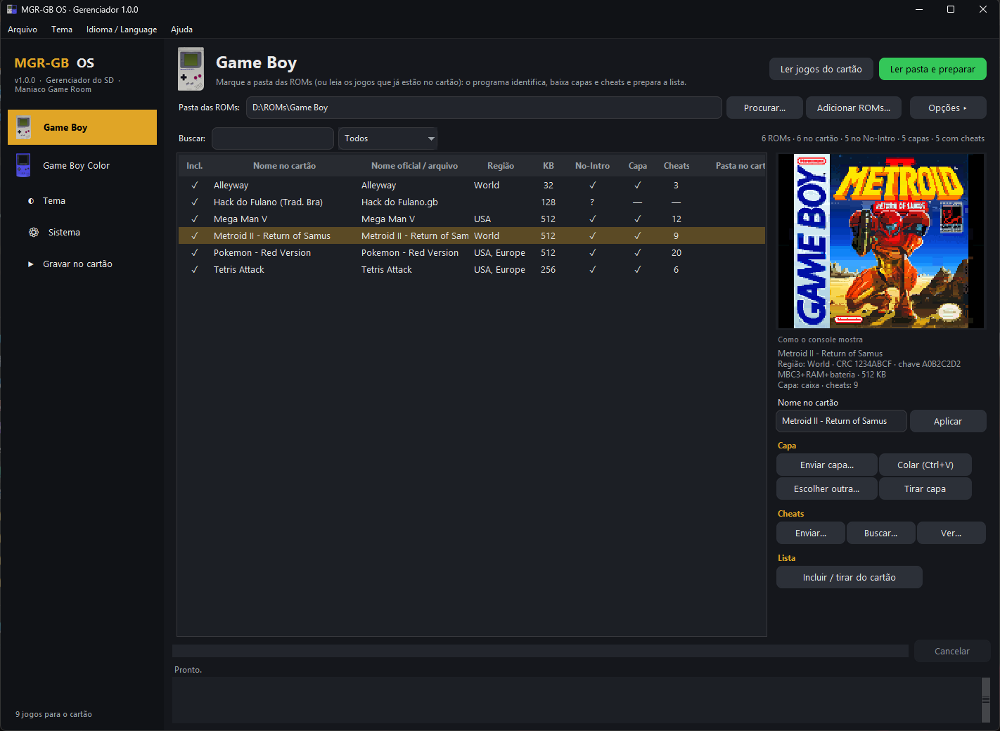

Com o cartão no PC:

1. **identifica cada ROM pelo conteúdo** (CRC32 contra o banco No-Intro), lê também ROMs dentro de `.zip` e escolhe as boas cópias;
2. **baixa a capa e os cheats** pelo nome oficial e converte a capa para o formato do console, no seu computador;
3. deixa você conferir a lista: **enviar a sua capa**, **escolher outra** (com prévia de como o console a mostra), enviar o seu `.cht`, editar o nome no cartão e incluir ou tirar jogos;
4. mostra o **plano arquivo por arquivo** e só grava depois do seu "sim";
5. instala o **MGR-GB OS** e grava os temas que você editou;
6. deixa as pastas em **ordem alfabética** (o menu mostra os jogos na ordem do cartão);
7. se o cartão **já tem jogos**, o botão **Ler jogos do cartão** lê todas as pastas da raiz sem mexer nos arquivos e só acrescenta capas, cheats, prévia e o menu.

O aplicativo funciona em **português ou inglês** (menu Idioma / Language), e o menu do console sai no mesmo idioma: trocou o idioma, é só gravar de novo (o programa avisa que o menu do cartão está em outro idioma). **Nada é apagado do cartão:** o que é substituído vai para uma pasta de backup, e cada arquivo é conferido depois de gravado.

| | |
|---|---|
| 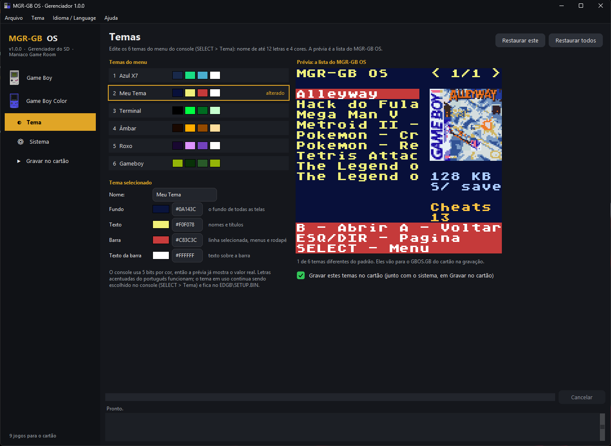 | 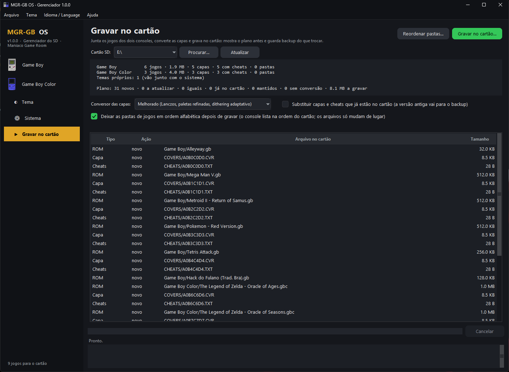 |

## Como usar

1. Baixe o **`MGR-GB-OS-Gerenciador.exe`** na página de **[Releases](../../releases)** (um arquivo só, sem instalar).
2. Coloque o cartão do EverDrive no PC, formatado em **FAT32**.
3. Abra `MGR-GB-OS-Gerenciador.exe`, escolha a pasta das suas ROMs em **Game Boy** e **Game Boy Color** e clique em **Ler pasta e preparar**.
4. Em **Gravar no cartão**, escolha a unidade e clique em **Gravar no cartão…**, confira o plano e confirme.
5. Use **Remover com segurança** no Windows, coloque o cartão no EverDrive e ligue o console.

O aplicativo **se atualiza sozinho**: ao abrir, avisa se há versão nova nas Releases e troca o `.exe` com um clique (Ajuda > Verificar atualizações…).

Passo a passo completo, com todas as telas: **[Manual](MANUAL.md)**.

## Requisitos

- Cartucho **EverDrive GB** com o sistema GBOS (testado no **EverDrive GB Extreme**, placa EXTREME REV.E). Os menus de outros modelos não foram testados.
- Windows 10 ou 11.
- Cartão microSD em **FAT32**.
- Internet na primeira vez (capas e cheats são baixados, convertidos e guardados no PC; a primeira gravação de uma biblioteca grande leva tempo, cerca de meia hora para ~1.000 capas).
- As **capas coloridas aparecem só num console com cores** (Game Boy Color). Num Game Boy sem cores o menu ignora a tela de capa.

## O que foi testado

| Item | Onde |
|---|---|
| Gravação do cartão pelo aplicativo (jogos, capas, cheats, prévia, menu) e lista com a prévia | **Game Boy Color + EverDrive GB Extreme**, cartão FAT32 |
| Ordem alfabética dentro das pastas e das duas pastas da raiz | **Game Boy Color + EverDrive GB Extreme**, cartão FAT32 |
| Voltar com **A** na lista sem “lixo de caracteres” na prévia (correção do menu) | **Game Boy Color + EverDrive GB Extreme** |
| Game Boy sem cores (DMG), outros modelos de EverDrive GB | Não testado |

A foto da lista de jogos (no topo) é do **console real**. As demais telas foram geradas no **emulador do próprio projeto** (que roda o menu real), com ROMs reduzidas só para a lista, e não são fotos do console.

## Aviso

O **MGR-GB OS é derivado do GBOS**, o sistema do EverDrive GB de Igor Golubovskiy (Krikzz): é o GBOS com traduções, capas, prévia, cheats e temas acrescentados. O aplicativo já traz o menu pronto; **este projeto não é afiliado à Krikzz** e os direitos do código original continuam com o autor. Veja **[TERCEIROS.md](TERCEIROS.md)**. ROMs não são fornecidas; capas e cheats são baixados dos projetos libretro e pertencem aos seus donos.

## Créditos

- GBOS e EverDrive GB: **Krikzz** — [krikzz.com](https://krikzz.com)
- Capas: [libretro-thumbnails](https://github.com/libretro-thumbnails) (a arte pertence aos respectivos titulares)
- Cheats e banco de jogos (No-Intro): [libretro-database](https://github.com/libretro/libretro-database)

## Licença

**Freeware — uso gratuito. © 2026 Maniaco Game Room. Todos os direitos reservados.** Veja a [licença](LICENCA.md) e os [componentes de terceiros](TERCEIROS.md).

Encontrou um problema? Abra uma [Issue](../../issues).
